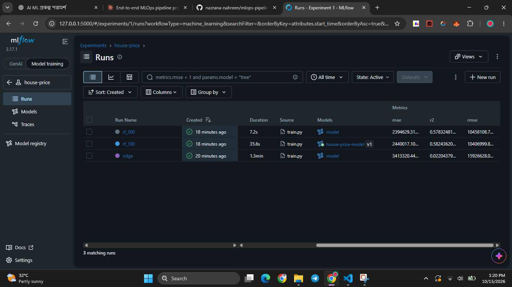
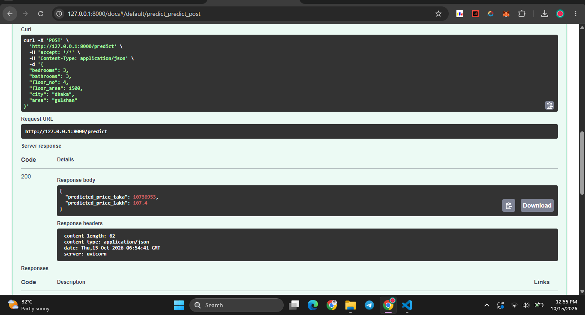

# House Price MLOps Pipeline


End-to-end MLOps pipeline for Bangladesh apartment price prediction:
**Validate → Train → Track → Serve → Contain → Automate**

## Pipeline

```
raw CSV → validate → clean → train 3 models (MLflow) → register champion
        → FastAPI → Docker → GitHub Actions (test + build + smoke test)
```

| Stage | Tool | What it does |
|---|---|---|
| Data validation | pandas | schema, price parsing, row-count and cleaning checks; fails the build on bad data |
| Preprocessing | scikit-learn | dedupe, outlier filters, imputation, one-hot encoding, inside a single sklearn pipeline |
| Experiment tracking | MLflow | params, metrics (MAE, RMSE, R²) and model per run |
| Model registry | MLflow | best run by RMSE registered, `champion` alias set |
| Serving | FastAPI | `/predict` with pydantic input validation, `/health` |
| Packaging | Docker | slim image with the champion model baked in |
| CI/CD | GitHub Actions | validate → train → register → pytest → docker build → container smoke test |

## Data
3,865 raw listings (Dhaka, Chattogram, Narayanganj, Gazipur, Cumilla).
After cleaning (duplicates, unparseable floors, price/area outliers): **2,612 rows**.

## Results

| Model | R² | MAE (BDT) |
|---|---|---|
| Ridge | 0.02 | 3.41M |
| RandomForest (100) ✅ champion | 0.58 | 2.44M |
| RandomForest (300) | 0.58 | 2.39M |

Model quality is not the focus here; the pipeline is. Ridge underperforms
(likely log-target + outliers); improving features is listed under future work.


## Run locally

```bash
pip install -r requirements.txt
python src/validate.py
python src/train.py
python src/register.py
pytest -q
uvicorn app.main:app --reload     # http://127.0.0.1:8000/docs
mlflow ui --backend-store-uri sqlite:///mlflow.db
```

## Docker

```bash
docker build -t house-price-api .
docker run -p 8000:8000 house-price-api

curl -X POST localhost:8000/predict -H "Content-Type: application/json" \
  -d '{"bedrooms":3,"bathrooms":3,"floor_no":4,"floor_area":1500,"city":"dhaka","area":"gulshan"}'
```


$r = Get-Content README.md -Raw -Encoding UTF8
$r = $r.Replace('','').Replace('','')
[System.IO.File]::WriteAllText((Join-Path (Get-Location) 'README.md'), $r, (New-Object System.Text.UTF8Encoding $false))
Select-String 'ss/ss' README.md
## Project structure

```
src/        clean, validate, train, register
app/        FastAPI service
tests/      pytest (cleaning + API)
params.yaml all config in one place
.github/    CI workflow
```

## Future work
- Drift monitoring (Evidently / Prometheus) and automated retraining
- Better features (location embeddings, price per sq ft) and hyperparameter search
- Cloud deployment (e.g. Render / AWS ECS) and image push to a registry